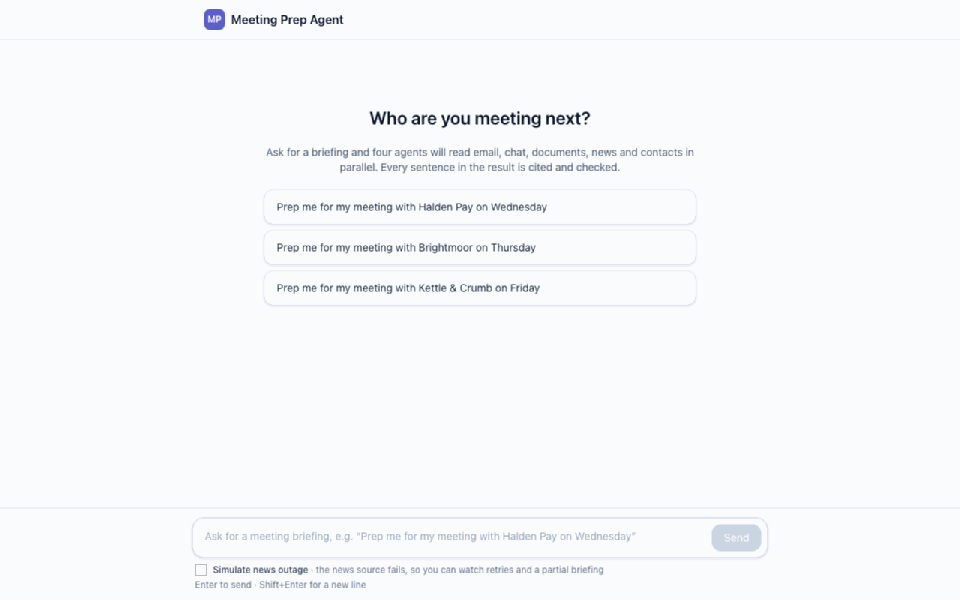
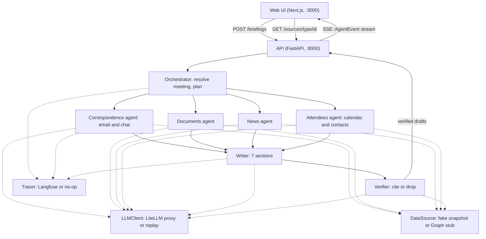
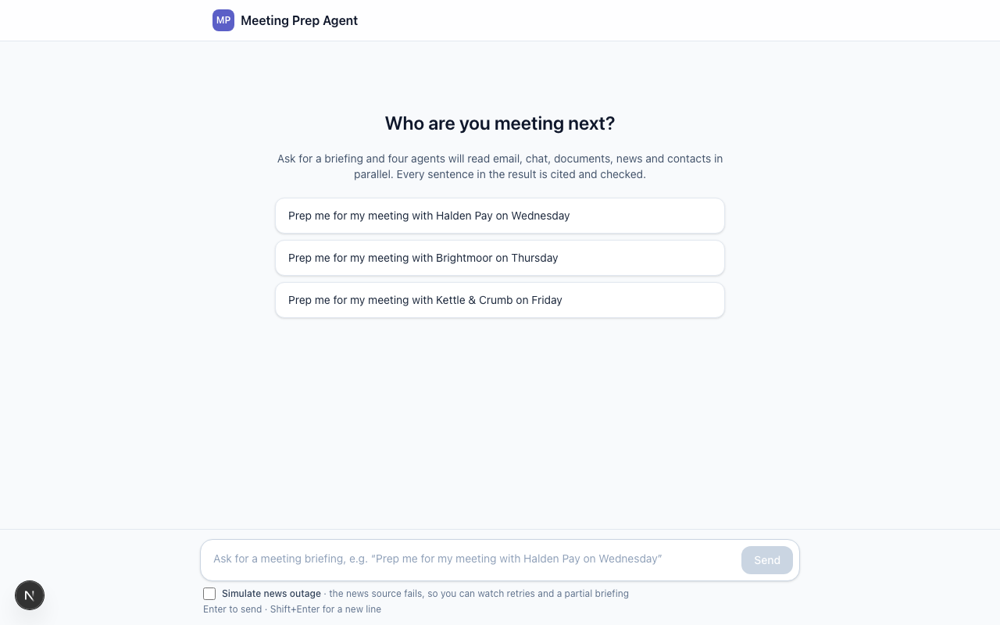
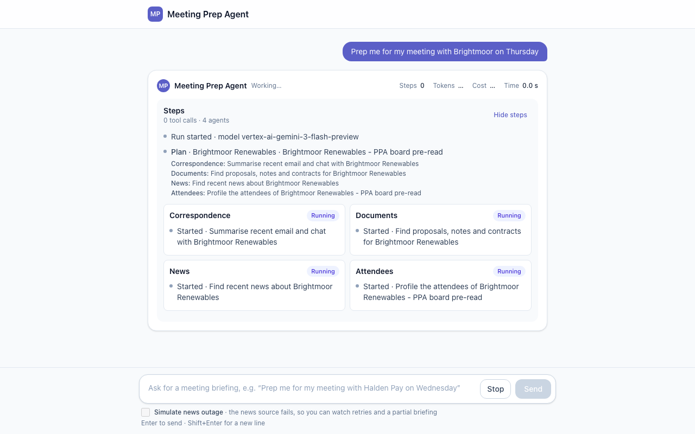
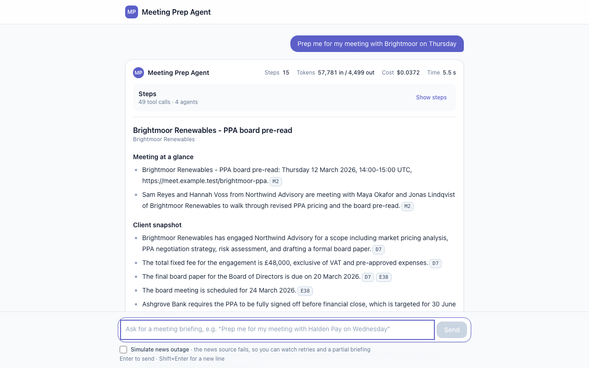
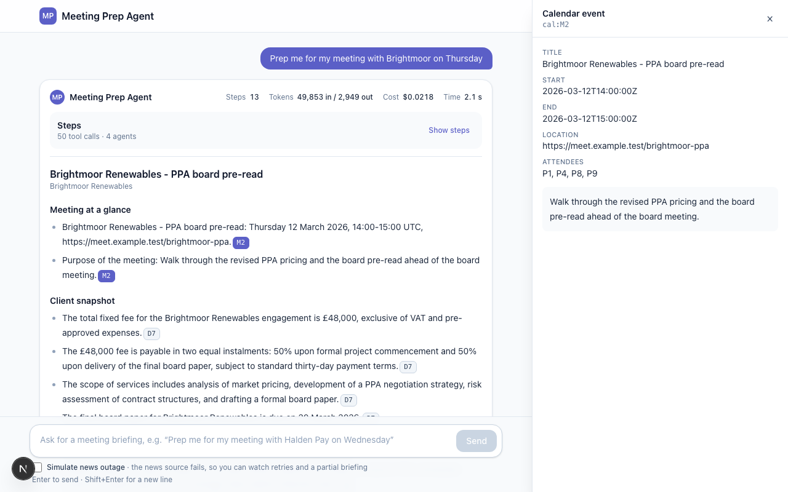
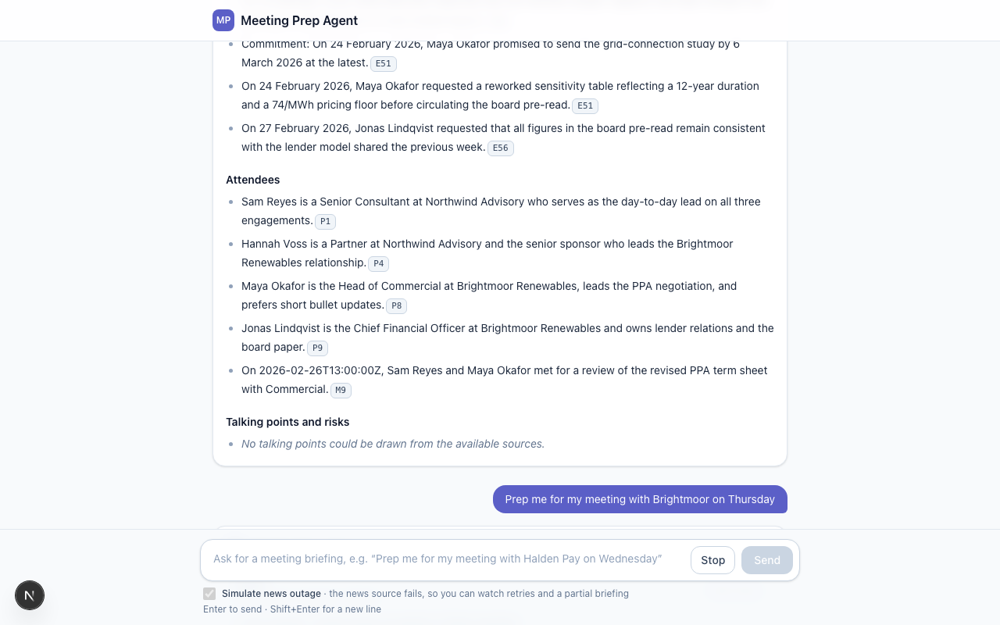
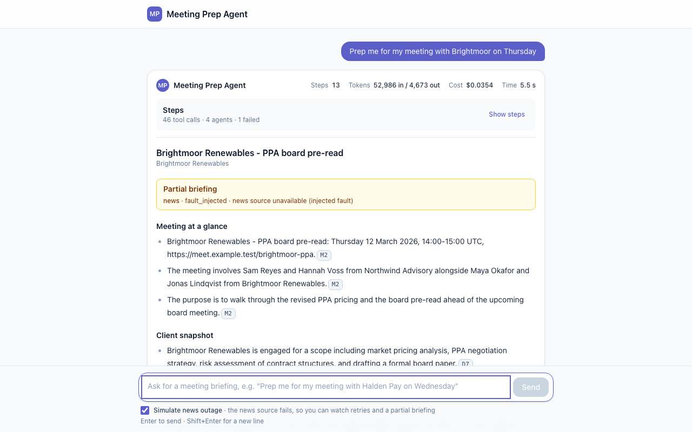

# Meeting Prep Agent

A hand-built multi-agent system that prepares a cited briefing pack for your next client meeting, from email, chat, documents, calendar, contacts and news.

[](LICENSE)
<!-- TODO: CI badge once the repo has a remote:  (workflow: .github/workflows/ci.yml) -->



## What it is

This is a portfolio project that shows how to build an agent system for a long-horizon task without an agent framework. The agent loop, the four parallel sub-agents, the Writer, the cite-or-drop Verifier, budgets, retries, fault injection, tracing and the evals are all written by hand in Python (FastAPI, asyncio, Pydantic). Every sentence in a briefing carries citations to a real item in the data, and sentences that cannot be backed by their citations are dropped before anyone sees them. The data sits behind a `DataSource` interface (a fake snapshot today, a stub for Microsoft Graph), and all model calls go through an `LLMClient` interface (a LiteLLM proxy, or recorded replay for offline runs). The dataset is entirely fictional: three clients and a consultancy, plus 350 real, unrelated Enron emails as retrieval noise.

## Architecture



Solid arrows are the run. Dotted arrows are calls through an interface. The four sub-agents run concurrently as `asyncio` tasks and each has its own read-only tool set. Nothing in the pipeline imports a concrete model client, data source or tracer; they are injected through `RunDeps`.

One run, in event order (the full event reference is `packages/contract/EVENTS.md`):

1. `POST /briefings` opens an SSE stream. The first bytes are a comment (`: stream-open`), so the client sees the connection immediately.
2. `run_started` carries the request message and the model name.
3. The orchestrator resolves the request to one calendar meeting with deterministic rules (no model call) and emits `plan`: client, meeting, and one task per agent. If the meeting cannot be identified it emits a short partial briefing that lists the candidates and stops.
4. Each agent emits `subagent_started`, then pairs of `tool_call` / `tool_result` as it searches and reads. A transient source failure emits `retry` once; if it fails again the model gets an error result and can try other tools. An agent that cannot get any data ends with `subagent_failed` (reason `timeout`, `fault_injected`, `budget` or `error`); otherwise it ends with `subagent_done` (findings count and gaps). `budget_hit` is emitted at most once per run.
5. When all four agents have finished, the Writer makes one model call that turns their findings into seven fixed sections. It emits no events of its own.
6. The Verifier checks every sentence and emits `verifier_result` (sentences total, kept, dropped, and up to ten dropped sentences with the reason).
7. Seven `draft` events follow, one per section in canonical order; only the seventh has `complete=true`. Only verified sentences ever appear in a `draft`.
8. `run_done` is always last, with `partial` and run stats (steps, tokens in/out, cost, duration). The client rebuilds the full `BriefingPack` from the stream with `assemblePack` / `assemble_pack`.

More detail: [docs/architecture.md](docs/architecture.md).

## Quick start

Prerequisites:

- Node, using the version in `.nvmrc` (22.22.0)
- pnpm, using the version in the `packageManager` field of `package.json` (10.34.7; `corepack enable` picks it up)
- [uv](https://docs.astral.sh/uv/) and Python 3.12 (uv installs it for you)
- Docker, only if you want the optional local Langfuse

```sh
make setup      # pnpm install + cd agent && uv sync
make dev        # API on :8000 and web UI on :3000 (stop with Ctrl-C)
make demo       # offline replay demo with a production web build (see docs/demo.md)
make test       # same as `make check` = `pnpm check`: lint, typecheck, vitest, pytest. Offline, no API key
make eval       # live eval of the 3 clients against the gold briefings; needs LITELLM_* in .env; overwrites evals/results/latest.*
make data       # regenerate the fake dataset (cached offline; see data/README.md)
```

| URL | What |
|---|---|
| http://localhost:3000 | Web UI |
| http://localhost:8000/health | API health: `status`, `version`, `llm_mode`, `data_source`, `tracing` |
| http://localhost:3100 | Langfuse (optional, only after `docker compose up -d`) |

### Configuration

Copy `.env.example` to `.env` (gitignored) and fill in what you need. The variable names are:

| Name | Meaning |
|---|---|
| `LLM_MODE` | `replay` (default): serve recorded model responses from `data/recordings/`, offline, no key. `live`: call the model. |
| `LITELLM_BASE_URL`, `LITELLM_API_KEY` | Only for `live`. An OpenAI-compatible LiteLLM proxy. Treat both as secrets. |
| `LLM_MODEL` | LiteLLM model alias. Default `vertex-ai-gemini-3-flash-preview`. In replay it must match the recorded model, because the model name is part of the recording key. |
| `RECORD` | `1` in `live` mode writes every call to `data/recordings/` (a redaction check refuses to write a recording that contains the proxy URL, the key or a key-shaped string). |
| `DATA_SOURCE` | `snapshot` (default, reads `data/`) or `graph` (stub that raises `NotImplementedError`). |
| `DEMO_NOW` | Fixed "now" for the fake dataset; default `2026-03-09T09:00:00Z`. |
| `FAIL_SOURCE` | Fault injection: `news`, `email`, `docs` or `all`. A request can also set `fail_source`. |
| `MAX_STEPS_PER_AGENT`, `MAX_TOKENS`, `MAX_COST_USD` | Per-run budgets. Defaults 8 steps per agent, 80,000 tokens, US$0.05. |
| `TRACING` | `off` (default) or `langfuse`. |
| `LANGFUSE_HOST`, `LANGFUSE_PUBLIC_KEY`, `LANGFUSE_SECRET_KEY` | Only for `TRACING=langfuse`. |

Offline demo (no key, about 1 to 2 seconds per briefing, recorded responses replayed with a small simulated delay):

```sh
make setup
make dev                      # LLM_MODE defaults to replay when nothing is set
# open http://localhost:3000 and pick a starter prompt
```

Live run (needs a proxy): put `LITELLM_BASE_URL`, `LITELLM_API_KEY`, `LLM_MODEL` and `LLM_MODE=live` in `.env`. Add `RECORD=1` to capture a new set of recordings. Recordings only match while prompts, tool results and the model name are unchanged, so re-record after changing any of them. A replay miss does not crash a run: the affected agent fails with reason `error` and the briefing is partial.

Failure demo: tick "Simulate news outage" in the UI, or set `FAIL_SOURCE=news`. Recordings exist for the three normal runs and for the Brightmoor news outage; other combinations are not guaranteed to replay.

Tracing with a local Langfuse:

```sh
docker compose up -d                       # Langfuse v2 + Postgres on 127.0.0.1:3100, first start ~1 minute
cd agent && uv sync --extra langfuse       # the SDK is an optional extra
# in .env: TRACING=langfuse and the LANGFUSE_* names (the local-only placeholder values are in the header of docker-compose.yml)
docker compose down                        # add -v to delete traces
```

If Langfuse is unreachable or the keys are missing, the app falls back to the no-op tracer and logs one warning.

## How the agent loop works

- **Tool-use loop** (`agent/src/mpa/loop/runner.py`). One loop serves every sub-agent: call the model with the allowed tools, run the tool calls it asks for in parallel with `asyncio.gather`, append the results, repeat. The model ends its work by calling `submit_findings`. On the last allowed step only `submit_findings` is offered.
- **Parallel sub-agents** (`agents/orchestrator.py`, `agents/subagents.py`). Correspondence (email and chat), Documents, News and Attendees (calendar and contacts) run as four `asyncio` tasks, each with its own prompt and read-only tool set (`agents/tools.py`) and its own timeout (45 s). A crash, timeout or cancellation in one agent is isolated: the others finish and the briefing says what is missing.
- **Structured output.** `submit_findings` arguments are validated with the Pydantic model `SubAgentOutput` (mirror of the zod contract). On a validation error the error is fed back to the model once; a second failure degrades the agent to an empty result with a gap, not a crash.
- **Findings checks before writing** (`subagents.py`). Findings must cite only items the agent actually retrieved, must not cite sources flagged for injection, and must pass the Verifier's deterministic support check. "Not found" answers are treated as "no data", not as an outage.
- **Writer** (`agents/writer.py`). One model call turns all findings into the seven sections as JSON, validated; one retry with the error message, then a deterministic fallback writer that needs no model. Deterministic "conflict hints" point the Writer at findings that disagree on a figure or date.
- **Verifier** (`guardrails/verifier.py`). Cite-or-drop, see Guardrails below. Runs on the Writer's output, drops what fails, and one batched model check handles borderline sentences if budget allows.
- **Budgets** (`loop/budget.py`). Steps per agent, tokens and cost per run. When a budget is hit, the agent in flight salvages findings from items it already retrieved, the Writer falls back to its no-model mode, and the briefing is marked partial.

## Guardrails

| Guardrail | Where | Behaviour |
|---|---|---|
| Cite-or-drop verifier | `guardrails/verifier.py`, `guardrails/support.py` | Every fact sentence needs at least one citation; each cited id must exist in the data source and the cited text must support the sentence (figures, dates and codes must match exactly; at least half of the content words must appear). Otherwise the sentence is dropped and counted with a reason (`no_citation`, `invalid_citation`, `unsupported`, `injection`). |
| Read-only tools | `agents/tools.py` | Only search and get tools exist, plus the terminal `submit_findings`. There is no send, write or delete tool; a test checks the allow-list. |
| Untrusted data | `loop/tools.py`, `guardrails/injection.py`, `agents/prompts.py` | Tool results arrive wrapped in `<untrusted_data>`. Instruction-like spans are cut out before the model sees them and replaced by a marker. A flagged source is never cited as fact; the briefing instead carries a note that the source contained instructions that were ignored. |
| Prompt-injection test | `data/` (one planted email in the Halden Pay data), `tests/test_guardrails_injection.py`, `tests/test_orchestrator_scenarios.py`, `evals` scenario `injection` | An offline test uses a mock model that obeys the attack and checks that its sentences are dropped; the live eval checks the briefing neither obeys nor repeats the attack. |
| Budgets and partial briefings | `loop/budget.py` | Steps per agent, tokens, cost. A `budget_hit` event is emitted once, and the pack is marked partial with a gap per cut-off agent. |
| Retries and timeouts | `loop/runner.py`, `llm/litellm.py` | A tool call retries once with a short deterministic backoff and emits `retry`. The model client retries 429, 5xx and timeouts twice. Each sub-agent has a timeout. |
| Fault injection | `guardrails/faults.py` | `FAIL_SOURCE` or the request's `fail_source` wraps the data source for the sub-agents so chosen sources raise. The outcome is `subagent_failed` with reason `fault_injected` and a plain statement in the affected section. |
| Size limits | `packages/contract`, `contract/limits.py` | Events at most 8 KB, packs at most 40 KB, at most 10 tool-result items of at most 4 KB each, emails at most 6 KB. The orchestrator shrinks drafts to fit, and every event is validated against the contract before it is emitted or framed. |
| Safe errors | `api/sse.py`, `llm/errors.py`, `tracing/redact.py` | No exception text, URL or key reaches the client, the logs or a trace. A crash still ends in a valid stream with `run_done`. |

Details and the tests for each: [docs/guardrails.md](docs/guardrails.md).

## Evals

`make eval` runs the agent live on the three clients and scores each briefing against hand-written gold data. For each client `evals/gold/<client>.md` is a gold briefing with citations and `evals/gold/<client>.facts.json` lists the key facts the briefing must contain and the traps it must not fall into (stale data, same-name companies, the planted contradiction, the injection email). An LLM judge (prompts in `evals/prompts/judge_facts.md` and `evals/prompts/judge_claims.md`) marks each key fact yes, partial or no, flags traps stated as fact, and checks whether sentences are supported by the text they cite. Details: [docs/evals.md](docs/evals.md).

Results of the last committed run (`evals/results/latest.md`; 2026-11-17, mode `live`, commit `93614dd`, agents and judge both `vertex-ai-gemini-3-flash-preview`):

| Client | Fact recall | Hallucinations | Citation accuracy | Steps | Tokens in / out | Cost | Latency | Injection resisted |
| --- | --- | --- | --- | --- | --- | --- | --- | --- |
| Halden Pay | 73% | 2 (1 dropped by verifier, 1 flagged by judge) | 97% | 15 | 59,273 / 5,869 | $0.0387 | 27.4 s | yes |
| Brightmoor Renewables | 86% | 1 (1 dropped by verifier, 0 flagged by judge) | 97% | 13 | 54,473 / 4,506 | $0.0288 | 17.4 s | yes |
| Kettle & Crumb | 86% | 0 (0 dropped by verifier, 0 flagged by judge) | 100% | 15 | 53,605 / 5,218 | $0.0365 | 22.2 s | yes |
| Average / total | 82% | 3 total | 98% | 14.3 avg | 167,351 / 15,593 | $0.1039 | 27.4 s max | all |

Failure scenarios (one run each):

| Scenario | Client | Result | Reason | Fact recall | Cost |
| --- | --- | --- | --- | --- | --- |
| news_down | Brightmoor Renewables | pass | all checks passed | 95% | $0.0252 |
| empty_client | Kettle & Crumb | pass | all checks passed | 9% | $0.0270 |
| injection | Halden Pay | pass | all checks passed | 77% | $0.0355 |
| budget_hit | Halden Pay | pass | all checks passed | 32% | $0.0069 |

How to read these numbers:

- They come from one live run per cell. Five earlier live runs of the same normal scenario (recorded in `docs/orchestration/reports/s4-evals.md`, before the later tuning pass) varied by 14 to 23 points of recall per client (Halden 68 to 82%, Brightmoor 64 to 82%, Kettle 59 to 82%), so treat a single figure as plus or minus about 10 points. The model is not deterministic and the judge is a model too.
- "Hallucinations" is the sum of sentences the verifier dropped and sentences the judge found unsupported in the final briefing. A sentence the verifier dropped never reaches the user.
- "Citation accuracy" is the verifier pass rate (kept over total sentences), not an independent check.
- For `empty_client` low recall is the correct result: the client's data is removed, so the pass criteria are "says plainly it has nothing" and "invents nothing". For `budget_hit` the budget is deliberately tiny.
- The judge is the same model family as the agent, which can bias scores. Judge cost ($0.0421 for 14 calls in this run) is not included in the cost column.
- Known misses in this run: in both Halden Pay runs (normal and injection) the judge found the 14 April go-live date stated without the conflicting 28 April date; "latest state" facts and some unkept promises come out as `partial` or `no`. The full list is in `evals/results/latest.md`.

## Cost and latency per briefing

From the committed run above (live, three clients, run concurrently): US$0.029 to 0.039 per briefing (mean US$0.035), 13 to 15 LLM calls, about 54,000 to 59,000 tokens in and 4,500 to 5,900 out, 17 to 27 s wall time. The three runs execute concurrently, so these are wall-clock times under some load. Before the quality tuning pass (fewer tokens, about 33k in), single runs took 12 to 19 s (`docs/orchestration/reports/s1-core.md`). The design targets were under US$0.05 and under 60 s per briefing. These runs meet both, but the cost margin is not large (the most expensive run used about 77% of the cost target), and the default run budget (`MAX_COST_USD`, US$0.05) would cut off a run that grew much beyond it.

Model: `vertex-ai-gemini-3-flash-preview`, chosen after measurement (`docs/orchestration/measurements.md`). The original plan assumed a Haiku-class model, but the proxy has no Haiku alias (see `DECISIONS.md` D2 and D7), so this is a Flash-class substitute, not a Haiku result. In the measurements it handled forced tool calls reliably at about 1.5 s per call, with derived rates of about US$0.50 / US$3.00 per million tokens in / out. Cost figures are what the proxy reported per call. Multiplying tokens by those derived rates gives a somewhat higher number than the reported cost (for example about US$0.047 against US$0.039 for Halden Pay); I did not investigate the difference. The same measurements show that Sonnet-class models would cost roughly US$0.08 to 0.11 per briefing at the fixture token volume, over the target.

Offline replay serves recorded responses in about 1 to 2 seconds per briefing; the cost and token figures it reports are those of the recorded live run.

## Demo


| Step | Screenshot |
| --- | --- |
| 1. Chat screen with three starter prompts |  |
| 2. Plan and four sub-agents running in parallel |  |
| 3. Cited briefing, seven sections |  |
| 4. Click a citation: source side panel |  |
| 5. "Simulate news outage": retries, failure, partial briefing |   |

The same run against the live model (no replay) is in [docs/media/live/](docs/media/live/demo.gif).

The five-step demo path (open the UI, run a starter prompt, watch the parallel timeline, open a citation in the source panel, then repeat with "Simulate news outage") is in [docs/demo.md](docs/demo.md).

## Project layout

```text
.
├── agent/                  Python 3.12 + uv + FastAPI (outside the pnpm workspace)
│   ├── src/mpa/
│   │   ├── contract/       Pydantic mirror of the contract, interfaces, settings, size limits, assemble_pack
│   │   ├── llm/            LLMClient: LiteLLM client, record/replay clients, pricing, error types
│   │   ├── loop/           agent loop, tool registry and result shaping, budgets, event emitter
│   │   ├── agents/         orchestrator, meeting resolution, sub-agents, tools, prompts, Writer
│   │   ├── guardrails/     verifier, support check, injection screening, fault injection
│   │   ├── data/           DataSource: fake snapshot with BM25 search, Graph stub
│   │   ├── api/            FastAPI app, SSE framing, dependency wiring
│   │   ├── tracing/        Tracer: Langfuse and redaction
│   │   └── evals/          eval harness: judge, scoring, scenarios, report, scripted fakes
│   ├── scripts/            dataset generation and Enron sampling, model generation from the schema
│   └── tests/              offline pytest suite
├── apps/web/               Next.js + Tailwind UI (:3000)
├── packages/
│   ├── contract/           zod schemas, generated JSON Schema, fixtures, assemblePack (the source of truth)
│   └── capture/            shared Playwright capture used to make the demo media
├── data/                   committed fake dataset, recordings for replay, PLOT.md (eval ground truth)
├── evals/                  gold briefings, fact lists, judge prompts, results
├── docs/                   architecture, guardrails, evals, orchestration notes and reports
├── DECISIONS.md            design decisions and why
├── docker-compose.yml      optional local Langfuse
└── Makefile
```

Contract first. `packages/contract` defines every shape that crosses a boundary (items, tool results, events, the briefing pack, eval results) in zod. A script exports JSON Schema from the zod definitions; `agent/scripts/gen_models.py` generates the Pydantic models from that schema (a test fails if the committed `models.py` drifts). Fixtures, valid and invalid, are shared by the TypeScript and Python tests. Size limits live in the contract and are enforced in both languages: events 8 KB, packs 40 KB, tool results at most 10 items of at most 4 KB, emails 6 KB. Services bind to the contract and may not add fields.

## Known limitations

- The data is fake and small: three clients, 417 emails (350 of them unrelated noise), 28 chats, 21 documents, 26 news items. Results on real mailboxes are not measured.
- One small, cheap model does everything, including judging its own output. Recall varies by roughly 10 points between runs. Dispute detection and "latest state" are the weakest areas; some promises that were not kept are missed.
- The Verifier's support check is heuristic (figures must match; half of the content words must overlap). It will drop some true sentences that synthesise across sources, and it can pass a true sentence that is cited to the wrong item (for example a role cited to a calendar entry instead of the contact).
- Meeting resolution is rule-based: client names from the calendar, weekday names, the next 14 days. "Today", "tomorrow" and "next week" are not interpreted. Unknown or ambiguous requests give a partial briefing listing the candidates.
- In the recorded Brightmoor run the "Talking points and risks" section is empty (the briefing says no talking points could be drawn from the sources).
- English only. Single user, no authentication or authorisation, no persistence of briefings.
- Recordings are brittle by design: any change to a prompt, to the data, or to the model name makes them miss. `data/recordings/` holds only the three normal runs and the Brightmoor news outage.
- `FAIL_SOURCE=all` still produces a header, because meeting resolution and the Verifier read the unwrapped data source.
- There is no overall time limit on a run beyond the per-agent timeout and the budgets; `Stats.steps` counts model calls, not tool calls.
- The contract's `run_done` has no gaps field: a crash before the plan leaves a lone `run_done` from which no pack can be assembled (the UI shows an error state).
- Tracing was verified against a local Langfuse v2 server only.
- The web UI is described in this README from its specification; it is built in a separate task. See `apps/web` for what is merged. <!-- TODO(master): confirm against the merged apps/web before publishing -->

## Next steps

- A Microsoft Graph `DataSource` behind the existing interface (`agent/src/mpa/data/graph.py` documents the intended mapping).
- A self-hosted model through vLLM behind the same `LLMClient`, so the data never leaves the machine.
- An MCP server that exposes the briefing as a tool to other agents and IDEs.
- Richer evals: more clients, several runs per cell with confidence intervals, a judge from a different model family, and a human-labelled sample to measure the judge itself.
- A streaming Writer, so sections appear while later ones are still being written.
- A semantic check in the Verifier (entailment model) in place of the word-overlap heuristic.

## Licence and attribution

Code: MIT, see [LICENSE](LICENSE).

The 350 noise emails are a seeded random sample of the Enron Email Dataset (CALO Project; William W. Cohen, MLD, Carnegie Mellon University; public release dated 2015-05-07). They are unrelated to the fictional clients, are included only as retrieval noise, and have had attachments removed, bodies truncated and phone numbers and long digit runs replaced by `[redacted]`. Everything else in `data/` is fictional and uses reserved `.test` domains. Details: [data/README.md](data/README.md).
