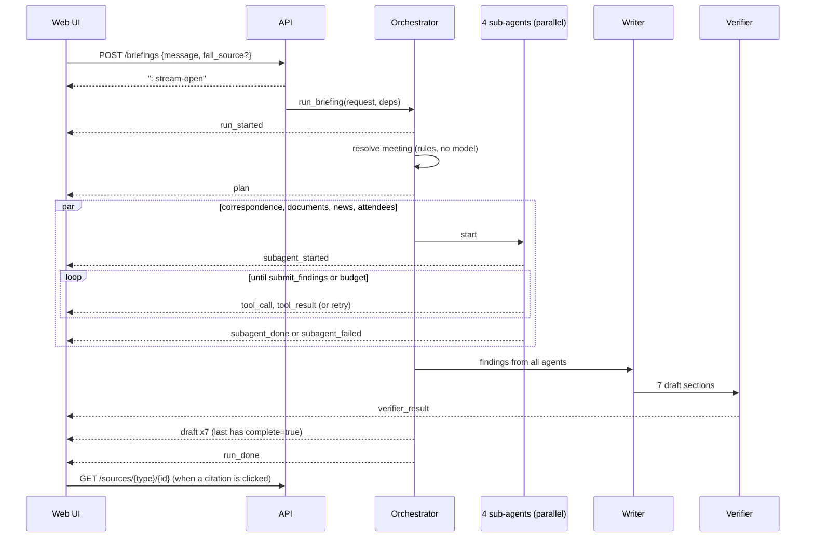

# Architecture

This page describes what is in `agent/`, `packages/contract` and `apps/web`. Paths are relative to the repository root.

## Components

| Component | Where | Responsibility |
|---|---|---|
| Contract | `packages/contract` (zod, JSON Schema, fixtures), `agent/src/mpa/contract` (Pydantic mirror, interfaces, settings, limits, `assemble_pack`) | Every shape that crosses a boundary: source items, tool results, `AgentEvent`, `BriefingPack`, `EvalResult`. Size limits. The three interfaces below. |
| API | `agent/src/mpa/api` | `GET /health`, `POST /briefings` (SSE), `GET /sources/{type}/{id}`. Frames events, sends keep-alives, cancels the run when the client disconnects, turns any crash into a valid terminal event sequence. CORS only for `localhost:3000` and `127.0.0.1:3000`. |
| Orchestrator | `agents/orchestrator.py`, `agents/resolve.py` | Resolves the request to one meeting with deterministic rules, emits `plan`, starts the four sub-agents, runs the Writer and Verifier, emits drafts and `run_done`. Owns the run `Budget`. |
| Sub-agents | `agents/subagents.py`, `agents/prompts.py`, `agents/tools.py` | Correspondence (email, chat), Documents, News, Attendees (calendar, contacts). Each is one prompt, one read-only tool set and one call to the agent loop. |
| Agent loop | `loop/runner.py`, `loop/tools.py`, `loop/budget.py`, `loop/events.py` | Model call, parallel tool calls, tool-result shaping (size caps, injection screening, `<untrusted_data>` wrapping), retries, budgets, event emission. |
| Writer | `agents/writer.py` | One model call that turns findings into seven sections; retry once on invalid JSON; deterministic fallback with no model call. |
| Verifier | `guardrails/verifier.py`, `guardrails/support.py`, `guardrails/injection.py` | Cite-or-drop on every sentence. |
| LLM clients | `llm/` | `LiteLLMClient` (OpenAI-compatible chat completions with tool calling), `ReplayClient`, `RecordingClient`, `build_llm_client`. |
| Data sources | `data/` | `FakeDataSource` (JSONL files in `data/`, BM25 search, deterministic ordering), `GraphDataSource` (stub). |
| Tracing | `tracing/` | `build_tracer`: no-op or Langfuse. One trace per run with nested spans for agents, steps and tools, and a generation per model call. |
| Evals | `evals/` (harness in `agent/src/mpa/evals`) | Gold briefings, judge prompts, results. See [evals.md](evals.md). |
| Web UI | `apps/web` | Chat UI that reads the SSE stream and the source endpoint. By contract the briefing text comes only from `draft` events (see `packages/contract/EVENTS.md`). Built in a separate task; check `apps/web` for what is merged. |

## Interfaces

Defined in `agent/src/mpa/contract/interfaces.py`. Service code depends on these, not on concrete classes.

- `LLMClient.chat(messages, tools=, temperature=, max_tokens=, tag=) -> LLMResponse` (message, token usage, cost in USD, latency). Implementations: `LiteLLMClient` (live), `ReplayClient` (serves `data/recordings/<sha256>.json`), `RecordingClient` (wraps a live client and writes recordings). `tag` is a label for traces and is not part of the replay key. The key is the SHA-256 of the canonical JSON of model name, messages, tools, temperature and max tokens. Tool call ids are renamed to `corr_1`, `docu_2`, ... so keys do not depend on provider ids.
- `DataSource`: `search_email`, `get_email`, `search_chat`, `get_chat`, `search_docs`, `get_doc`, `get_calendar`, `search_news`, `get_news`, `get_contact`, `find_contacts`, `get_source`. Search returns at most 10 hits of at most 4 KB. An unknown id raises `KeyError` (not retried; reported to the model as "no data"). A transient failure raises `DataSourceError` (retried once). `GraphDataSource` raises `NotImplementedError`; its docstring records how Microsoft Graph objects map to the contract.
- `Tracer` / `Span`: synchronous, non-blocking, never raises. `NoopTracer` when `TRACING=off`.
- `RunDeps(llm, data, tracer, settings)` is the single object passed through a run.

## Data flow

Notes:

- The orchestrator is an async generator. A producer task runs the pipeline and puts events on a queue; the generator yields them. If the consumer goes away (client disconnect), the producer and every child task are cancelled.
- Sub-agents write to one shared `Budget` (steps per agent, tokens and cost for the run). `begin_step` is the check before every model call; the first agent to hit a limit emits the single `budget_hit`.
- After the agents finish, the orchestrator collects their findings, adds deterministic "conflict hints" for findings that disagree on a figure or date, and passes everything to the Writer together with the list of unavailable sources.
- The Verifier fetches each cited item through `DataSource.get_source`, so a citation is checked against the same data the UI later shows in the source panel. Meeting-line sentences built from the calendar item itself are added before verification.
- After verification the orchestrator adds plain notes for failed or budget-cut agents, for sources that contained instructions, and for sections with no content, then shrinks drafts to fit the caps (7,000 bytes per draft event, 36,000 for the pack, against contract limits of 8 KB and 40 KB).
- The finished briefing is not sent as one object. A pack can be up to 40 KB and an event at most 8 KB, so clients rebuild the `BriefingPack` from the stream with `assemblePack` (TypeScript) or `assemble_pack` (Python); decision D9 in `DECISIONS.md`. Gaps and `partial` are derived from `subagent_failed`, `subagent_done.gaps` and `budget_hit`.

## Event sequence and ordering rules

`run_started`, `plan`, then per agent `subagent_started` ... `subagent_done` | `subagent_failed` (the four agents interleave), at most one `budget_hit` anywhere, `verifier_result`, exactly seven `draft` events in canonical section order, `run_done` last, always. `seq` is strictly increasing from 0 within a run. `check_event_order` (both languages) returns the violations for a stream and is used in tests, not at run time. Section ids, in order: `meeting_at_a_glance`, `client_snapshot`, `recent_news`, `where_we_left_off`, `open_items`, `attendees`, `talking_points_and_risks`.

## Failure behaviour

| Situation | What happens |
|---|---|
| Source raises a transient error | `retry` event, one more attempt after a short deterministic backoff. A second failure becomes an error result for the model. |
| An agent gets no data at all | `subagent_failed`. The matching sections say so in a note; other sections complete; `partial=true`, with a gap naming the source. |
| Model returns invalid `submit_findings` | The validation error is given back once; a second failure degrades the agent to an empty result with a gap. |
| Model returns no tool call | One nudge to call `submit_findings`, then degrade. |
| Agent timeout (45 s), crash or cancellation | That agent ends with `subagent_failed`; the others continue. |
| Budget reached | One `budget_hit`. Agents salvage findings from what they already retrieved; the Writer runs without a model. `partial=true`. |
| Writer returns invalid JSON | One retry with the error, then the deterministic writer. |
| Replay has no recording for a request | The calling agent fails with reason `error`; the stream stays valid. |
| Meeting cannot be identified | A short partial briefing that lists candidate meetings; no sub-agents run. |
| Unexpected exception in the pipeline | The orchestrator emits a safe terminal sequence ending in `run_done` with `partial=true`. The API does the same if the run function itself fails or ends without `run_done`. No exception text reaches the client. |
| Client disconnects | The run and all child tasks are cancelled; the tracer is flushed. |

## Serving

`GET /health` never touches the model or data and reports the configured `llm_mode`, `data_source` and `tracing`. `POST /briefings` takes `{message, fail_source?}` (message 1 to 2,000 characters) and returns `text/event-stream`: one `event: <type>` and one compact `data:` JSON line per event, a keep-alive comment every 10 s, and the stream ends after `run_done`. `GET /sources/{type}/{id}` returns a source item (404 unknown id, 422 bad type or id, 503 source unavailable). Dependencies (settings, data source, model client, tracer) are built on first use, so `/health` works even when the model is not configured.
